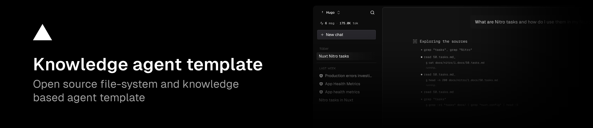

<p align="center">
  <b>Acuity.Agent</b><br>
  <i>Creating pathways to wisdom.</i><br><br>
  <a href="https://acuity.institute">acuity.institute</a>
  ·
  <a href="https://github.com/ejfsensus/Acuity.Agent2.0-Railway">GitHub</a>
</p>

---

Acuity.Agent is the knowledge agent for the [Acuity Institute](https://acuity.institute). The Institute is dedicated to truth and the expansion of accurate knowledge, enlightening pathways of understanding across all areas of life. This repository is **Acuity.Agent 2.0**, prepared for deployment on Railway.

The public site puts it this way: achieving wisdom through knowledge, and enlightening pathways of understanding. The Acuity Library is a pathway to individual enlightenment, meant to improve lives, communities, and society. This agent is the instrument that searches that library and answers from what it actually finds.

## What the agent can read today

The sacred-text library is vendored at `Texts/sacred_texts_archive/`. On startup the app copies it into the sandbox at `docs/sacred-texts/`, which is where the agent runs `grep`, `find`, and `cat`. `Texts/sacred_texts_archive/ATTRIBUTION.txt` names each collection, the edition to cite, and the downloads that were empty or failed their checksum. Plain text, HTML, and USX are searchable. PDF and Office files in that tree are stored, and `grep` does not read them.

Other sources still arrive through sync. Until an administrator adds one and runs a sync, the sandbox has this library and nothing else. The agent is instructed to answer from files it finds, and to say when a passage is not in the available sources.

What it can reach, once configured:

| Access | What it is | In this repo now |
|---|---|---|
| Knowledge base | The vendored sacred-text library, plus Markdown, MDX, YAML, JSON, TXT, HTML, and USX synced from sources. The agent searches the sandbox with `grep`, `find`, and `cat`. | Sacred texts are at `Texts/sacred_texts_archive/`, mounted as `docs/sacred-texts/`. |
| GitHub sources | A repository or docs path, synced on demand | None configured in code. |
| YouTube sources | Transcripts from a channel, up to the configured video limit | None configured in code. Needs `NUXT_YOUTUBE_API_KEY`. |
| File sources | Documents uploaded in the admin panel | None stored in git. |
| Chat attachments | Files a person attaches to one conversation | Per chat, not a standing library. |
| Web search | Brave Search and Brave LLM context, used only after the sandbox has been searched | Optional. Needs `BRAVE_API_KEY`. |

The product docs in `docs/` and `apps/app/app/content/docs/` describe how to run the software. They are not the Institute library, and they are not mounted as the agent's knowledge base unless someone adds them as a source.

### What the public site names, and what this agent does not hold

These appear on [acuity.institute](https://acuity.institute). They are not files in this repository, and the agent cannot quote them until they are added as sources and synced.

- **The Acuity Library.** The site describes it as a pathway to enlightenment. This repository vendors the sacred-text archive under `Texts/sacred_texts_archive/`. It does not include a separate catalogue page from the public site.
- **LumenNous** ([lumennous.acuity.institute](https://lumennous.acuity.institute)). A separate prayer engine. The site describes a library of seventy-two prayers and guided practices. That library is not part of Acuity.Agent.
- **The Archive, The Lens, and Taking Action.** Listed under Instruments of Clarity. The site marks them Coming Soon. They are not implemented in this codebase.
- **Webinars and Acuity Shorts.** Titles and descriptions are published on the site (testimony, consciousness, self-worth, and related talks). The agent does not have those transcripts unless a YouTube or file source is synced.
- **The model’s general training.** The chat prompt tells the agent not to treat memory as a source. If the sandbox does not contain a text, the agent should say it could not find it.

The built-in library includes the Internet Sacred Text Archive downloads, the American Standard Version (1901) in USX, and the Berean Standard Bible in plain text. Works that were not in those downloads are still absent. The agent should say so rather than quote from memory.

## How a text becomes available

1. Sign in as an admin and open `/admin`.
2. Add a source: a GitHub repository, a YouTube channel, or an uploaded file set.
3. Sync. Sync keeps `.md`, `.mdx`, `.yml`, `.yaml`, `.json`, `.txt`, `.html`, `.htm`, and `.usx`, and drops other file types.
4. The agent then searches that tree. It cites the file path it read.

Source fields, sync behaviour, and the snapshot layout are in [docs/SOURCES.md](./docs/SOURCES.md).

## Run it locally

```bash
bun install
cp apps/app/.env.example apps/app/.env
bun run dev
```

Set `BETTER_AUTH_SECRET` and `NUXT_PUBLIC_SITE_URL` before expecting sign-in to work. Model access needs either the Vercel AI Gateway key or an OpenAI-compatible endpoint. The full variable list is in [docs/ENVIRONMENT.md](./docs/ENVIRONMENT.md).

```bash
bun run build
bun run test
bun run lint
bun run typecheck
```

## Railway

Production is intended to run from the Dockerfile on Railway, with Postgres for users, chats, and sources. The current deployment notes, including the database-driver fix, are in [docs/RAILWAY-DEPLOYMENT.md](./docs/RAILWAY-DEPLOYMENT.md).

Repository: [github.com/ejfsensus/Acuity.Agent2.0-Railway](https://github.com/ejfsensus/Acuity.Agent2.0-Railway)

## What else it can do

- Chat on the web, with the search steps shown as they run.
- The same agent on GitHub and Discord, when those bots are configured.
- An admin assistant for usage, errors, users, and sources.
- Shareable read-only conversations.

Architecture is in [docs/ARCHITECTURE.md](./docs/ARCHITECTURE.md). Branding, tools, and bot adapters are in [docs/CUSTOMIZATION.md](./docs/CUSTOMIZATION.md).

## Institute

[acuity.institute](https://acuity.institute) · Beyond the Horizon of Knowledge · Est. 2026

Correspondence: [hello@acuity.institute](mailto:hello@acuity.institute)

## License

[MIT](./LICENSE)
